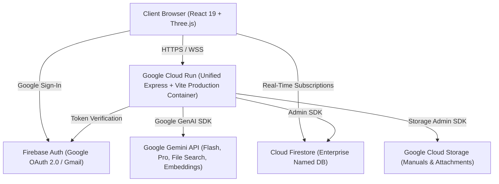

<div align="center">

# CNC Copilot

**Industrial Assistive AI Platform and Deterministic Machining Simulator**

*AI explains. Physics decides.*

[](https://cnc-copilot-857267445589.asia-south1.run.app)
[](https://ai.google.dev/)
[](https://react.dev/)
[](https://threejs.org/)
[](https://www.typescriptlang.org/)
[](https://vitest.dev/)

</div>

---

## Overview

**CNC Copilot** is a production-grade industrial platform built for shopfloor machinists, CNC operators, manufacturing technicians, and tooling engineers. It bridges generative artificial intelligence with rigorous, deterministic mechanical engineering.

Operating modern Computer Numerical Control (CNC) machinery demands zero room for error: an incorrect feed rate, ungrounded alarm diagnosis, or unverified G-code block can break a \$5,000 carbide toolholder, scrap expensive aerospace alloys, or cause catastrophic machine collision.

CNC Copilot adheres to a strict governing law:
> **AI explains. Physics decides.**  
> Generative models explain symptoms, transcribe voice, and parse multimodal diagnostics, but all feeds, speeds, cutting forces, tool life estimations, and collision boundaries are computed deterministically.

---

## Key Modules

### 1. Shopfloor Diagnostic Agent
- **Multimodal Camera Diagnosis**: Operators capture live machine control panel displays, error messages, or damaged workpiece parts using built-in device camera feeds.
- **Hands-Free Shopfloor Audio**: Voice recording via MediaRecorder with backend inline speech transcription powered by Google Gemini.
- **Strict OEM Grounding (RAG)**: Diagnostics query genuine OEM manuals (Fanuc, Mitsubishi, Siemens, Haas) indexed in Gemini File Search Stores.
- **Structured Resolution Cards**: Displays Alarm Code, Description, Root Causes, Prescribed Recovery Actions, and Safety Warnings.
- **Natural Intent Classification**: Conversational queries render as standard chat bubbles, while critical machine alarms trigger diagnostic cards.

### 2. Machining Calculator and 3D Simulation
- **Deterministic Kienzle Force Engine**: Computes specific cutting force ($k_c$), tangential force ($F_c$), cutting power ($P_c$), spindle torque ($M_d$), chip thickness ($h$), and material removal rate (MRR) based on DIN standard mechanical engineering formulas.
- **Interactive Three.js 3D Viewport**:
  - High-contrast 4-flute cutter geometry with alternating tungsten carbide and protective coatings, gold TiN inserts, and arbor drive keys rendering visible rotation at calculated spindle RPM.
  - Process-specific tool kinematics: X-axis sweep for milling, sinusoidal plunge and retract for drilling/tapping/boring.
  - Dynamic chip ejection sparks reacting in real time during active tool-workpiece engagement.
  - Timeline scrubber synchronized with cut cycle progress, plus play/pause, replay reset, and 0.5x / 1.0x / 1.5x speed multipliers.
- **4 Machining Operations**: Milling, Drilling, Tapping (with canned G84 cycle block generation), and Boring.

### 3. Academy (Crash Lab)
- **Virtual 3D Machine Enclosure**: Real-time Three.js scene featuring 3-axis CNC vertical machining center with spindle, vises, clamps, and stock workpiece.
- **Server-Authoritative Crash Detection**: Evaluates G-code programs block-by-block on the server, interpolating 0.5mm samples against rapid traverse boundaries to detect crashes.
- **Progressive Certification Path**: Guided missions from basic facing to advanced contouring with interactive AI tutoring.
- **Live Global Trainee Telemetry**: Real-time learner metrics, crash statistics, and administrative trainee roster drawer.

### 4. Knowledge Base (RAG)
- **Automated Vector Pipeline**: Upload PDF/DOCX manuals to Google Cloud Storage with automated vector indexing in Gemini File Search Stores (`models/gemini-embedding-001`).
- **Citation Integrity**: Every AI response cites verified manual excerpts. If ungrounded, the system states "Not found in your uploaded manuals."

### 5. Unified Google Single Sign-On (SSO)
- **Shared Authentication**: Centralized Google OAuth 2.0 / Gmail sign-in across all modules (`/agent`, `/academy`, `/kb`, `/calculator`).
- **Cryptographic Backend Guard**: Express routes authenticate Firebase Admin JWT tokens on every protected request.

---

## System Architecture



For the complete technical specification, data models, Kienzle formulas, and security rules, see the **[Technical Architecture Specification](docs/ARCHITECTURE.md)**.

---

## Tech Stack

| Layer | Technologies |
| :--- | :--- |
| **Frontend Framework** | React 19, TypeScript, Vite, Tailwind CSS v4 |
| **3D Graphics & Physics** | Three.js, React Three Fiber (@react-three/fiber), Drei (@react-three/drei) |
| **Backend & Runtime** | Node.js 22, Express, tsx |
| **AI Models & SDK** | Google Gemini 2.5 Flash, Gemini 2.5 Pro, `@google/genai` SDK v2.4.0 |
| **Vector Search (RAG)** | Gemini File Search Stores (`models/gemini-embedding-001`) |
| **Database & Identity** | Cloud Firestore (Enterprise Named DB), Firebase Authentication (Google OAuth 2.0) |
| **Cloud Infrastructure** | Google Cloud Run (`asia-south1`), Google Cloud Storage, Google Cloud Build |
| **Testing & Quality** | Vitest, Playwright (E2E against local and live deployments), Custom Design Guard |

---

## Getting Started

### Prerequisites
- Node.js 22+
- npm 10+
- A Google Gemini API key ([Google AI Studio](https://aistudio.google.com/))
- Firebase project credentials (`cnc-copilot-abc26`)

### Installation

1. **Clone the repository:**
   ```bash
   git clone https://github.com/bsknbsk/cnc-copilot.git
   cd cnc-copilot
   ```

2. **Install dependencies:**
   ```bash
   npm install
   ```

3. **Configure environment variables:**
   Create `.env.local` in the project root:
   ```env
   GEMINI_API_KEY="your-gemini-api-key"
   VITE_FIREBASE_API_KEY="your-firebase-api-key"
   VITE_FIREBASE_AUTH_DOMAIN="cnc-copilot-abc26.firebaseapp.com"
   VITE_FIREBASE_PROJECT_ID="cnc-copilot-abc26"
   VITE_FIREBASE_STORAGE_BUCKET="cnc-copilot-abc26.firebasestorage.app"
   ```

4. **Start the local development server:**
   ```bash
   npm run dev
   ```
   Open [http://localhost:3000](http://localhost:3000) in your browser.

---

## Verification & Testing

CNC Copilot maintains high test coverage across physics calculations, G-code evaluation, security rules, and UI invariants:

```bash
# Run unit and physics calculation tests
npm test

# Run TypeScript compilation check
npm run lint

# Run UI Design Guard verification
npm run guard:design

# Run Playwright End-to-End tests locally
npm run test:e2e

# Run Playwright E2E tests against live production deployment
npm run test:e2e:live
```

---

## Deployment

The application runs as a unified containerized full-stack service on Google Cloud Run:

```bash
# Build production bundle
npm run build

# Deploy to Google Cloud Run
gcloud run deploy cnc-copilot \
  --source . \
  --region asia-south1 \
  --project cnc-copilot-abc26 \
  --quiet
```

**Live Production URL:** [https://cnc-copilot-857267445589.asia-south1.run.app](https://cnc-copilot-857267445589.asia-south1.run.app)

---

## Security and Governance

- **Secret Isolation**: `GEMINI_API_KEY` and service account keys exist strictly server-side. Secrets are never exposed to browser bundles or committed to git.
- **Server Recomputation**: XP awards, badges, levels, and user roles are computed exclusively server-side. Client-supplied progression metrics are ignored.
- **Design Freeze**: All user interface changes are audited against `design-lock.json` via `scripts/design-guard.mjs` to ensure visual layout and styling remain stable.

---

## License

This project is licensed under the Apache 2.0 License.