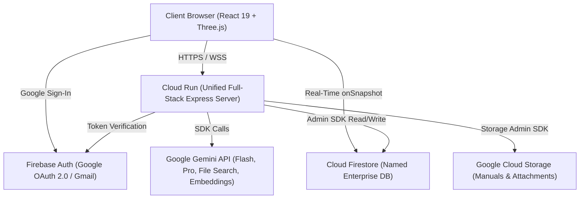
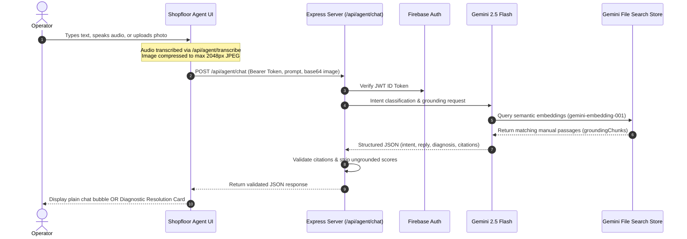
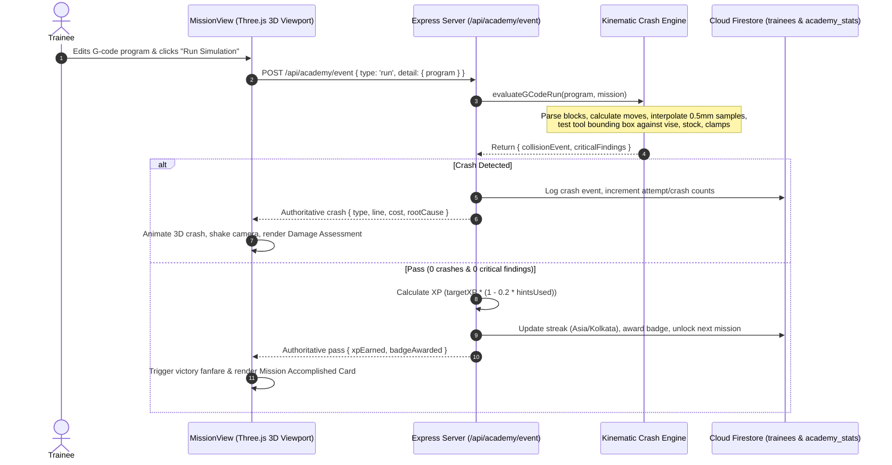
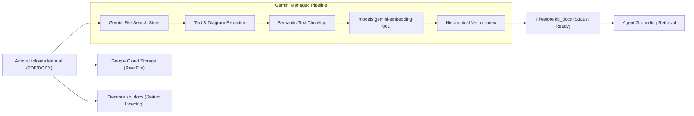

# CNC Copilot: Technical Architecture and System Specification

> AI explains. Physics decides.

This document provides a comprehensive technical reference for the CNC Copilot system, detailing the architecture, Google Cloud and Gemini API integrations, end-to-end data workflows, deterministic physics computation, security guardrails, and deployment topology.

---

## 1. System Overview and Core Principles

CNC Copilot is an industrial assistive AI platform designed for shopfloor machinists and manufacturing engineers operating Computer Numerical Control (CNC) machine tools (Fanuc, Mitsubishi, Siemens, and Generic ISO G-code). 

### Core Design Rules
1. **Deterministic Physics Superiority**: Generative AI never invents cutting speeds, feeds, tool wear, power, or crash limits. Kinematic and physical computations are executed deterministically by dedicated physics engines.
2. **Ungrounded Hallucination Zero-Tolerance**: Citations and diagnostic resolutions come strictly from Gemini File Search retrieval against authenticated OEM manuals. If no manual passage matches, the system states "Not found in your uploaded manuals."
3. **Server-Authoritative Progression**: In the Academy (Crash Lab), all collision detections, XP grants, levels, streaks, and badges are calculated server-side to guarantee tamper-proof progression.
4. **Unified Single-Sign-On**: A shared Google/Gmail identity model protects core endpoints while preserving frictionless access across all operational modules.



---

## 2. Google Cloud and Gemini Suite Integrations

| Technology / Product | Specific Feature / Version | Purpose and Implementation in CNC Copilot |
| :--- | :--- | :--- |
| **Google Cloud Run** | Fully managed containerized service (`asia-south1`) | Hosts the unified Express + Vite production service with automated zero-downtime traffic migration. |
| **Google Gemini API** | `gemini-2.5-flash` (`MODEL_FLASH`) | Powers high-speed intent detection, multimodal controller image diagnosis, speech-to-text audio transcription, and interactive tutoring. |
| **Google Gemini API** | `gemini-2.5-pro` (`MODEL_PRO`) | Deep G-code program analysis, multi-stage reasoning for complex machining faults, and code optimizations. |
| **Gemini File Search Stores** | `ai.fileSearchStores` (`models/gemini-embedding-001`) | Managed semantic vector database. Ingests OEM manuals, generates dense vector embeddings, chunks documents, and executes RAG grounding. |
| **Cloud Firestore** | Enterprise Named Database (`ai-studio-cnccopilot-...`) | Real-time operational database for user profiles, trainee progress, simulation logs, and knowledge base document indexes. |
| **Firebase Authentication** | Google Identity Provider (OAuth 2.0) | Cross-module Single Sign-On (SSO) with cryptographic JWT token verification on the backend. |
| **Google Cloud Storage** | Persistent Object Storage Bucket | Stores uploaded PDF/DOCX OEM manuals, machine controller screen captures, and operator audio recordings. |
| **@google/genai SDK** | Official Node.js SDK (`v2.4.0`) | Communicates with Gemini models, vector stores, and structured JSON output schemas without third-party wrappers. |

---

## 3. End-to-End Architectural Workflows

### 3.1. Shopfloor Agent Multimodal Diagnostic Flow



#### Intent Differentiation
1. **Greeting / Small Talk**: Concise reply (under 2 sentences) offering assistance with alarms, feeds/speeds, or G-code.
2. **General CNC Question**: Plain markdown response under 180 words.
3. **Alarm / Fault**: Renders structured Diagnostic Resolution Card containing Alarm Code, Alarm Text, Likely Causes, Prescribed Recovery Steps, and mandatory Safety Warnings.
4. **Cutting Parameters**: Defers to deterministic physics formulas; never fabricates numbers.
5. **G-Code Explanation**: Technical breakdown of modal codes and coordinate trajectories.

---

### 3.2. Academy (Crash Lab) Kinematic Simulation Flow



---

### 3.3. Knowledge Base Ingestion and Vector Search (RAG)



---

## 4. Deterministic Physics and Kinematics Engine

The physics calculation pipeline does not rely on Large Language Models for arithmetic. Calculations use standard mechanical engineering formulations:

### 4.1. Kienzle Cutting Force Formulation
Specific cutting force $k_c$ accounts for chip thickness compression:
$$k_c = k_{c1.1} \cdot h^{-m_c} \cdot \left(1 - \frac{\gamma_o}{100}\right)$$

Where:
- $k_{c1.1}$: Specific cutting force for $1\text{ mm}^2$ chip area
- $h$: Nominal chip thickness ($f_z \cdot \sin \kappa_r$)
- $m_c$: Material-specific chip thickness exponent
- $\gamma_o$: Tool rake angle

### 4.2. Power and Torque Computations
Tangential cutting force $F_c$, cutting power $P_c$, and spindle torque $M_d$:
$$F_c = a_p \cdot f_z \cdot z \cdot k_c$$
$$P_c = \frac{F_c \cdot v_c}{60 \cdot 1000 \cdot \eta}$$
$$M_d = \frac{P_c \cdot 9550}{n}$$

Where:
- $a_p$: Axial depth of cut (mm)
- $f_z$: Feed per tooth (mm/tooth)
- $z$: Active number of teeth
- $v_c$: Cutting velocity ($\frac{\pi \cdot D \cdot n}{1000}\text{ m/min}$)
- $\eta$: Machine transmission efficiency ($\approx 0.85$)
- $n$: Spindle rotational speed (RPM)

---

## 5. Security, Access Control, and Governance

### 5.1. Authentication and Authorization Architecture
- **Shared Session Context**: Managed client-side by `AuthContext.tsx` listening to Firebase Auth state tokens.
- **Route Authorization Guard**: Unauthenticated requests to protected screens (`/agent`, `/academy`, `/kb`, `/`) immediately redirect to the Google Sign-In Landing Page.
- **Server Verification**: Every Express route (except `GET /api/health`) validates the incoming `Authorization: Bearer <token>` through Firebase Admin Auth.

### 5.2. Cloud Firestore Declarative Rules
```javascript
rules_version = '2';
service cloud.firestore {
  match /databases/{database}/documents {
    match /{document=**} { allow read, write: if false; }

    function isSignedIn() { return request.auth != null; }
    function isOwner(uid) { return isSignedIn() && request.auth.uid == uid; }

    match /users/{uid} {
      allow read: if isOwner(uid);
      allow update: if isOwner(uid) && !request.resource.data.diff(resource.data).affectedKeys().hasAny(['role']);
      allow create: if isOwner(uid) && (!('role' in request.resource.data) || request.resource.data.role == 'user');
    }

    match /trainees/{uid} {
      allow read: if isOwner(uid);
      allow write: if false; // Server writes only
      match /sessions/{sessionId} {
        allow read: if isOwner(uid);
        allow write: if false;
      }
    }

    match /academy_stats/global {
      allow read: if isSignedIn();
      allow write: if false;
    }

    match /kb_docs/{docId} {
      allow read: if isSignedIn();
      allow write: if false;
    }
  }
}
```

### 5.3. Design Guard Automation
To prevent regression of the approved UI design:
- `scripts/design-guard.mjs` verifies SHA-256 hashes of 16 core interface files against `design-lock.json`.
- Scans 27 `.tsx` components to verify that none of the 847 approved Tailwind className strings are removed or reordered.
- Executed on every CI/CD pre-commit pipeline and Cloud Run deployment check.

---

## 6. Infrastructure and Deployment Topology

```mermaid
graph TB
    subgraph Client Tier
        Browser["Modern Browser (Desktop Chrome, Safari, Android)"]
    end

    subgraph Google Cloud Platform (asia-south1)
        LB["Cloud Run HTTPS Load Balancer"]
        Container["Container Instance (Node 22 + Express + Vite Static SPA)"]
        
        subgraph Data & Storage
            FirestoreDB["Firestore Enterprise (Named DB)"]
            StorageBucket["Cloud Storage Bucket (Manuals & Attachments)"]
        end
    end

    subgraph Google AI Services
        GeminiAPI["Gemini 2.5 Flash / Pro API"]
        Retriever["File Search Stores (Vector DB)"]
    end

    Browser -->|TLS 1.3 / HTTPS| LB
    LB --> Container
    Container -->|gRPC / REST| FirestoreDB
    Container -->|Storage API| StorageBucket
    Container -->|GenAI SDK| GeminiAPI
    GeminiAPI <--> Retriever
```

### Deployment Configuration
- **Project ID**: `cnc-copilot-abc26`
- **Region**: `asia-south1` (Mumbai)
- **Production Service URL**: `https://cnc-copilot-857267445589.asia-south1.run.app`
- **Container Architecture**: Linux x86_64 single container handling server-side API routing and client static bundle delivery.
